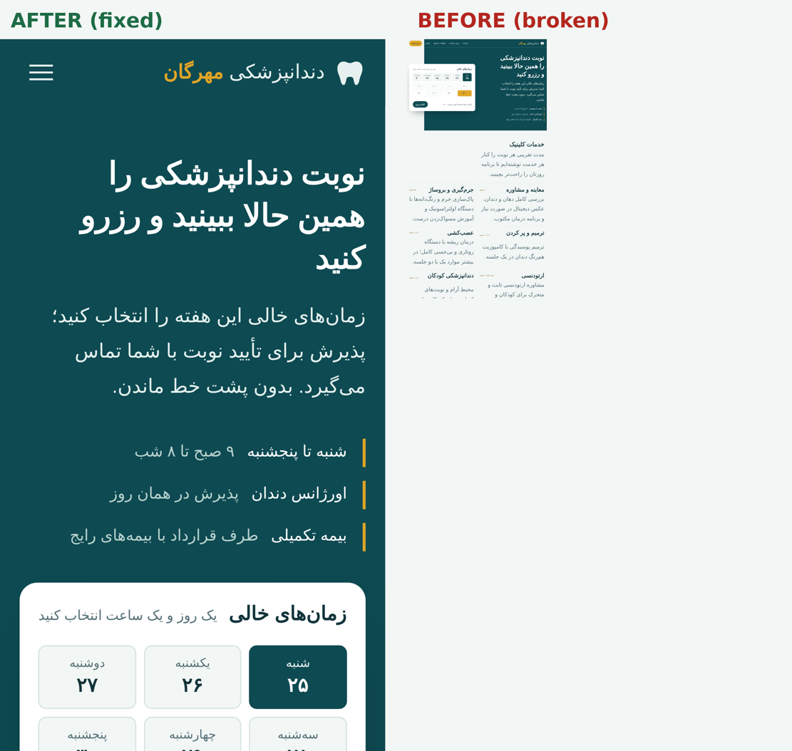

# Bug Fix Lab — تشخیص و رفع ۵ باگ رایج وب‌سایت

> **نمونه‌کار شخصی.** باگ‌ها بر اساس الگوهای رایج در سایت‌های واقعی، روی یک صفحه نمونه بازتولید شده‌اند. ارزش این پروژه در فرایند است: بازتولید، علت‌یابی، رفع و اثبات با تست خودکار.

**دموی آنلاین:** https://mtzdeveloper.github.io/bug-fix-lab/ (هر دو نسخه، قبل و بعد از رفع باگ)



## مسئله

صفحه‌ای که روی دسکتاپ درست به نظر می‌رسد، در موبایل ریز و Zoom‌شده دیده می‌شود، اسکرول افقی دارد، منو باز نمی‌شود، فرم ناقص ارسال می‌شود و دکمه اصلی کلیک نمی‌خورد. این‌ها رایج‌ترین شکایت‌های صاحبان سایت‌های کوچک هستند.

## روش کار

1. **بازتولید:** هر مشکل با گام‌های مشخص بازتولید شد.
2. **علت‌یابی:** با DevTools (Console، Inspect، حالت دستگاه) علت ریشه‌ای پیدا شد، نه فقط نشانه.
3. **رفع:** کمترین تغییر لازم، بدون اثر جانبی روی بخش‌های دیگر.
4. **اثبات:** برای هر باگ یک تست خودکار Playwright نوشته شد که روی `broken/` شکست می‌خورد و روی `fixed/` موفق می‌شود.

جزئیات هر باگ در [docs/BUGS.md](docs/BUGS.md) است.

| کد | مشکل | علت |
| --- | --- | --- |
| B01 | اسکرول افقی در موبایل | عرض ثابت ظرف اصلی |
| B02 | منوی موبایل کار نمی‌کند + خطای Console | اسکریپت بدون `defer` و نبود بررسی `null` |
| B03 | فرم نیمه‌کامل ارسال می‌شود | شرط منطقی اشتباه در اعتبارسنجی |
| B06 | دکمه رزرو کلیک نمی‌خورد | لایه تزئینی روی دکمه |
| B10 | صفحه در موبایل ریز است | نبود تگ viewport |

## اجرا

پیش‌نیاز: Node.js نسخه LTS. در ویندوز، تست‌ها با **Microsoft Edge** نصب‌شده روی سیستم اجرا می‌شوند و دانلود مرورگر لازم نیست. دانلود مرورگر خود Playwright در بعضی کشورها، از جمله ایران، مسدود است.

```bash
npm install

npm run test:broken   # باید شکست بخورد: وجود باگ‌ها را ثابت می‌کند
npm test              # باید کاملاً موفق باشد: رفع باگ‌ها را ثابت می‌کند
npx playwright show-report
```

دیدن هر نسخه در مرورگر:

```bash
npm run serve:broken   # http://localhost:4173
npm run serve:fixed
```

اگر Edge ندارید و Google Chrome نصب است، پیش از اجرای تست در PowerShell بنویسید: `$env:PW_CHANNEL="chrome"`

## ساختار

```
bug-fix-lab/
├── broken/              نسخه دارای باگ
├── fixed/               نسخه اصلاح‌شده
├── tests/bugs.spec.js   تست هر باگ
├── docs/BUGS.md         گزارش کامل باگ‌ها
├── docs/screenshots/
├── playwright.config.js تست در دو حالت موبایل و دسکتاپ
└── package.json
```

## محدودیت‌ها

- باگ‌ها عمداً بازتولید شده‌اند؛ این پروژه روی سایت هیچ مشتری‌ای انجام نشده است.
- تست‌ها روی موتور Chromium (Edge یا Chrome) اجرا می‌شوند. برای پوشش Safari، پروژه `webkit` را به `playwright.config.js` اضافه کنید.

## این فرایند روی سایت شما

همین روش روی نسخه پشتیبان یا محیط آزمایشی سایت شما اجرا می‌شود و همراه تحویل، گزارش باگ‌ها، فهرست تغییرات و روش بازگشت را دریافت می‌کنید.
